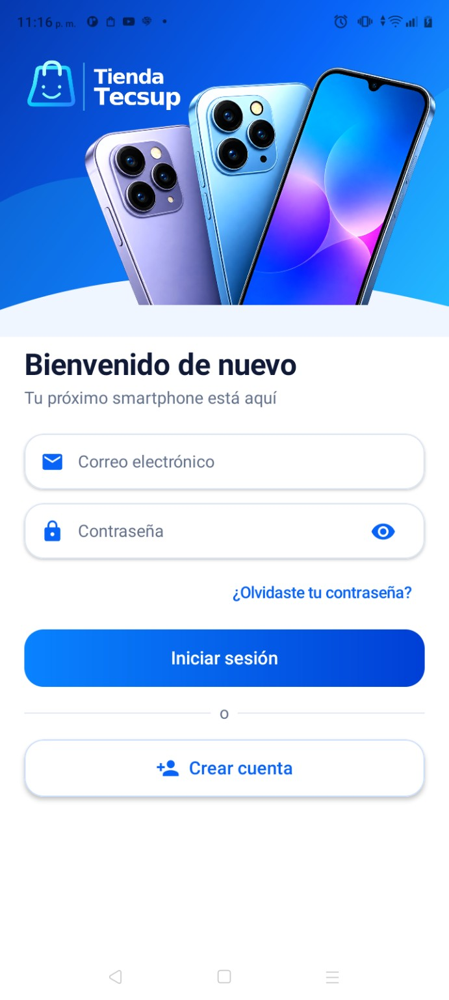
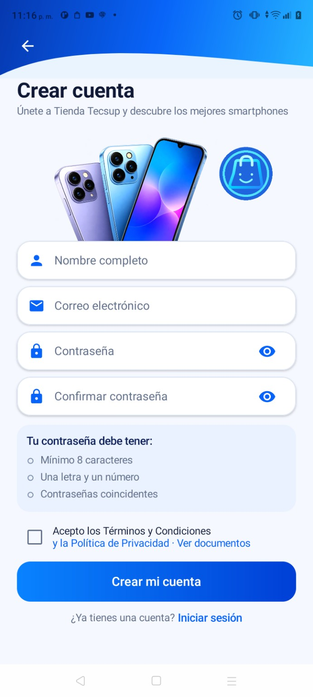
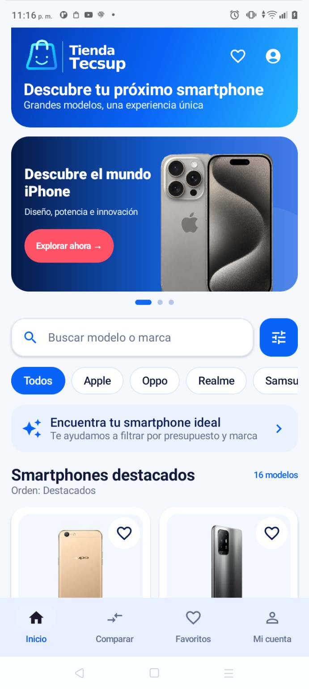
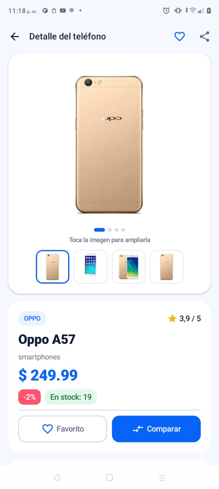
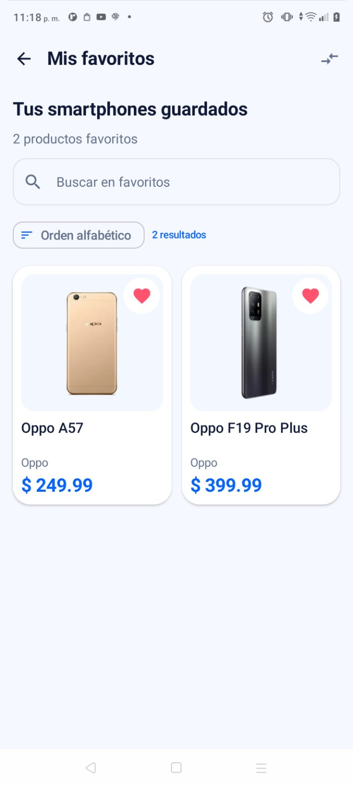
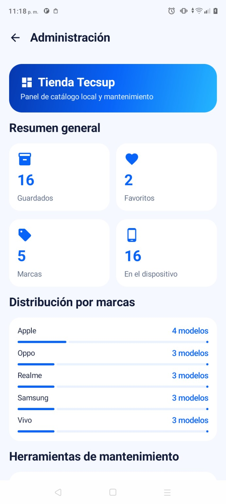
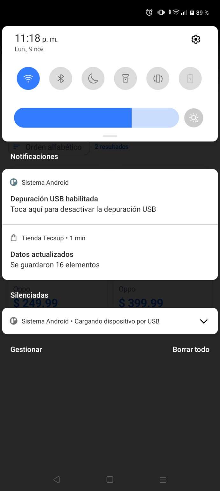
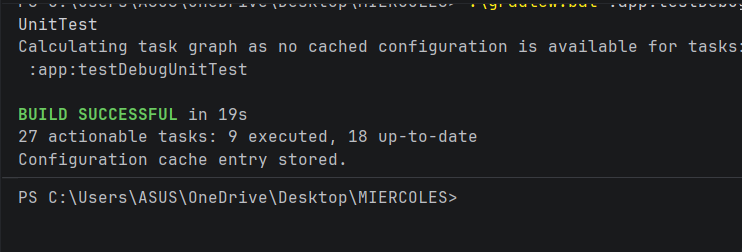

<div align="center">
  <h1>📱 Tienda Tecsup</h1>
  <p><strong>Catálogo de smartphones para Android · Laboratorio 11–12</strong></p>
  <p>Kotlin · Jetpack Compose · Material 3 · MVVM · Retrofit · Room · Firebase</p>
  <p><a href="https://github.com/LuisMaldo3/lab-integrador-g01-Maldonado">Repositorio GitHub</a> · <a href="https://github.com/LuisMaldo3/lab-integrador-g01-Maldonado/tree/mejora-ia">Fase 2: mejora-ia</a></p>
</div>

---

## 📋 Descripción

**Tienda Tecsup** es una aplicación Android para **explorar, consultar, comparar y guardar smartphones**. Obtiene el catálogo desde [DummyJSON](https://dummyjson.com/) mediante Retrofit y conserva los productos descargados y sus favoritos localmente con Room. La autenticación se realiza con Firebase Authentication y el rol de cada cuenta se consulta en Cloud Firestore.

El proyecto corresponde al **Laboratorio 11–12 de Programación en Móviles**, grupo **G01**, del programa de **Diseño y Desarrollo de Software — Tecsup**.

- **Estudiante:** Luis Miguel Maldonado Linares.
- **Tema y variante:** Productos — `smartphones`.
- **Paquete Android:** `com.tecsup.productos`.
- **Rama `main`:** desarrollo inicial (Fase 1, sin IA).
- **Rama `mejora-ia`:** pruebas unitarias, rediseño de interfaz y registro de prompts (Fase 2).

> **Alcance:** es una aplicación de consulta de productos. **No implementa pagos, carrito de compra ni envíos**. El catálogo proviene de una API pública de solo lectura; el panel administrativo no modifica el inventario remoto.

## ✨ Funcionalidades

| Módulo | Funcionalidad |
|---|---|
| **Autenticación** | Inicio de sesión con correo y contraseña, registro, recuperación de contraseña, persistencia de sesión y cierre de sesión. |
| **Roles** | Acceso diferenciado para usuario y administrador, con rol consultado en Firestore. |
| **Catálogo** | Banners promocionales, búsqueda por modelo o marca, filtros, ordenamiento y guía para encontrar teléfonos según presupuesto y marca. |
| **Detalle** | Galería de imágenes, selección de miniaturas, ampliación de fotografía, precio, descripción, disponibilidad, valoración y productos relacionados cuando hay datos. |
| **Favoritos** | Marcar y desmarcar productos, consultar guardados y conservar favoritos tras sincronizar. |
| **Comparador** | Comparar hasta tres smartphones utilizando los datos disponibles del catálogo. |
| **Mi cuenta** | Consultar correo y rol, acceder a secciones, cambiar entre tema claro, oscuro o del sistema y cerrar sesión. |
| **Administración** | Resumen de productos locales, favoritos, marcas, distribución por marca, sincronización y limpieza de caché. |
| **Offline** | Mostrar el catálogo almacenado en Room sin conexión e indicar cuándo se usan datos guardados. |
| **Notificaciones** | Notificación local al terminar la sincronización con la cantidad de elementos guardados, respetando permisos de Android. |

> La **lista y los favoritos** tienen respaldo local. El **detalle completo** se solicita mediante un endpoint de la API, por lo que algunas de sus funciones pueden requerir Internet.

## 📸 Evidencias de la aplicación

Las siguientes son **capturas reales de la aplicación ejecutándose en un teléfono Android**, correspondientes a la versión con mejoras de interfaz en `mejora-ia`. Los valores del catálogo pueden variar según la API o el estado local de la aplicación.

### 1. Acceso y registro

<table>
<tr>
<td align="center" width="50%"><strong>Inicio de sesión</strong></td>
<td align="center" width="50%"><strong>Crear cuenta</strong></td>
</tr>
<tr>
<td align="center"></td>
<td align="center"></td>
</tr>
</table>

### 2. Catálogo y detalle del smartphone

<table>
<tr>
<td align="center" width="50%"><strong>Catálogo y búsqueda</strong></td>
<td align="center" width="50%"><strong>Ficha de producto</strong></td>
</tr>
<tr>
<td align="center"></td>
<td align="center"></td>
</tr>
</table>

### 3. Favoritos y administración

<table>
<tr>
<td align="center" width="50%"><strong>Mis favoritos</strong></td>
<td align="center" width="50%"><strong>Panel de administración</strong></td>
</tr>
<tr>
<td align="center"></td>
<td align="center"></td>
</tr>
</table>

### 4. Notificación local después de sincronizar

<div align="center">
  
</div>

La captura muestra el aviso **«Datos actualizados — Se guardaron 16 elementos»**, generado después de la sincronización del catálogo.

## 🏗️ Arquitectura MVVM

La aplicación separa la interfaz, los estados de presentación y el acceso a datos:

```text
Jetpack Compose (pantallas)
        │ observa UiState / StateFlow
        ▼
     ViewModel
        │ usa contratos
        ▼
Repository (interfaces e implementaciones)
        ├── Retrofit ──► DummyJSON (API pública)
        ├── Room ──────► Caché local y favoritos
        └── Firebase ──► Authentication + Firestore (sesión y roles)

NotificadorAndroid ──► Notificación local con NotificationCompat
```

El repositorio de productos utiliza **Room como fuente de datos de la lista**. La sincronización consulta Retrofit, actualiza la base local y conserva los favoritos previamente marcados.

**Estructura principal:**

```text
app/src/main/java/com/tecsup/productos/
├── AppContainer.kt
├── MainActivity.kt
├── data/
│   ├── auth/          # Firebase Auth y rol de Firestore
│   ├── local/         # Room: Entity, DAO y Database
│   ├── mapper/        # DTO ⇄ Entity ⇄ modelo
│   ├── preferences/   # Preferencia de tema
│   ├── remote/        # Retrofit, DTO y endpoints
│   └── repository/    # Contratos y repositorio de productos
├── domain/model/      # Item, Sesion y Rol
├── notification/      # Notificaciones locales
└── ui/
    ├── admin/         # Panel del administrador
    ├── comparador/    # Comparación de modelos
    ├── components/    # Componentes visuales reutilizables
    ├── detalle/       # Detalle de producto
    ├── favoritos/     # Productos favoritos
    ├── lista/         # Catálogo
    ├── login/         # Acceso, registro y recuperación
    ├── navigation/    # Rutas y navegación Compose
    ├── perfil/        # Mi cuenta y apariencia
    └── theme/         # Paleta y tipografía Material 3
```

## 🛠️ Tecnologías

| Tecnología | Uso en el proyecto |
|---|---|
| **Kotlin** | Lenguaje principal. |
| **Jetpack Compose + Material 3** | Interfaz de usuario declarativa y componentes visuales. |
| **MVVM, ViewModel y StateFlow** | Separación de responsabilidades y estados Cargando, Éxito y Error. |
| **Navigation Compose** | Navegación entre pantallas y control de acceso a Administración. |
| **Retrofit + OkHttp + Kotlin Serialization** | Consumo y procesamiento de la API. |
| **Room** | Almacenamiento local de catálogo y favoritos. |
| **Firebase Authentication** | Registro, acceso, recuperación y sesión. |
| **Cloud Firestore** | Lectura del rol de la cuenta. |
| **Coil** | Carga de fotografías desde URL. |
| **NotificationCompat** | Notificaciones locales tras sincronizar. |
| **JUnit + kotlinx-coroutines-test** | Pruebas unitarias de `ListaViewModel` en JVM. |

### API utilizada

**Base:** `https://dummyjson.com/`

| Consulta | Endpoint |
|---|---|
| Lista de smartphones | `GET /products/category/smartphones` |
| Detalle de un producto | `GET /products/{id}` |

Los precios e imágenes dependen de los datos que entrega DummyJSON. **No son precios de venta oficiales de Tecsup**.

## 🚀 Instalación y ejecución

### Requisitos

- Android Studio compatible con la configuración Gradle del proyecto.
- **JDK 21** configurado para el daemon de Gradle (ver `gradle/gradle-daemon-jvm.properties`).
- Android SDK correspondiente a `compileSdk 37` instalado o disponible para descarga.
- Dispositivo o emulador Android con **API 24 o superior**.
- Internet para la primera sincronización y autenticación.
- Un proyecto Firebase propio y configurado.

### Pasos

**1. Clonar el repositorio**

```bash
git clone https://github.com/LuisMaldo3/lab-integrador-g01-Maldonado.git
cd lab-integrador-g01-Maldonado
git switch mejora-ia
```

**2. Abrir el proyecto en Android Studio** y esperar la sincronización de Gradle.

**3. Configurar Firebase**

- Crear o seleccionar un proyecto en [Firebase Console](https://console.firebase.google.com/).
- Registrar la aplicación con el paquete `com.tecsup.productos`.
- Habilitar **Authentication → Correo electrónico/Contraseña**.
- Habilitar Cloud Firestore.
- Descargar el archivo `google-services.json` desde Firebase y colocarlo **localmente** en `app/google-services.json`.
- Crear las cuentas de prueba y asignarles su rol en la colección `usuarios` de Firestore, con documento identificado por su **UID** y un campo de texto `rol` con valor `admin` o `usuario`.
- Aplicar reglas de seguridad de Firestore apropiadas: cada persona solo debe poder consultar sus propios datos de sesión y no debe poder autoconcederse el rol `admin`.

**4. Ejecutar la aplicación:** seleccionar un celular/emulador y pulsar **Run ▶** en Android Studio.

> **Seguridad:** el archivo `google-services.json`, las contraseñas, `local.properties` y los datos privados de prueba **no se publican en GitHub**. La versión del laboratorio no implementa un backend propio de administración de productos; el acceso de administrador se decide por el rol leído de Firestore.

## ✅ Pruebas unitarias

Se agregaron **seis pruebas para `ListaViewModel`**, ejecutables en la JVM sin Android, Room ni Retrofit reales, mediante un repositorio falso, un notificador falso y una regla de dispatcher de corrutinas.

| N.º | Escenario probado |
|---|---|
| 1 | Carga exitosa: de `Cargando` a `Exito`. |
| 2 | Error de conexión sin datos almacenados. |
| 3 | Mostrar datos locales y aviso cuando no hay conexión. |
| 4 | Solicitar la notificación con el número de elementos sincronizados. |
| 5 | Conservar un favorito tras sincronizar nuevamente. |
| 6 | Reintentar después de un error y recuperar la lista. |

**Ejecutar pruebas y generar APK debug en Windows:**

```powershell
.\gradlew.bat :app:testDebugUnitTest
.\gradlew.bat :app:assembleDebug
```

La ejecución mostrada en la evidencia finalizó con **`BUILD SUCCESSFUL in 19s`** para `:app:testDebugUnitTest`. El proyecto también se abrió en un teléfono Android durante la revisión. Estas evidencias no reemplazan todas las pruebas manuales de aceptación.

<div align="center">
  
</div>

El APK de depuración se genera habitualmente en `app/build/outputs/apk/debug/app-debug.apk` tras una compilación exitosa. Para la entrega, adjuntarlo a la versión **`v1.0`** de GitHub, no al código fuente.

## 🔎 Comprobaciones funcionales recomendadas

- [ ] Ingresar con usuario normal y verificar que no ve Administración.
- [ ] Ingresar como administrador y abrir el panel.
- [ ] Validar mensajes para campos vacíos y credenciales incorrectas.
- [ ] Abrir el catálogo, buscar, filtrar y ordenar modelos.
- [ ] Abrir la ficha de un teléfono y cambiar la imagen desde miniaturas.
- [ ] Guardar y quitar favoritos; cerrar y volver a abrir la aplicación.
- [ ] Sincronizar y comprobar que no desaparecen los favoritos.
- [ ] Probar catálogo sin conexión con y sin datos locales.
- [ ] Probar los botones Sincronizar y Limpiar caché como administrador.
- [ ] Confirmar la notificación de sincronización y la app cuando se niega su permiso.
- [ ] Navegar entre Comparador y Mi cuenta; verificar cierre de sesión.
- [ ] Girar el dispositivo y comprobar que no se reinicia innecesariamente la carga.

## 🤖 Fase 2 — Mejora con IA

La mejora se desarrolló en la rama **`mejora-ia`** y se documenta en el archivo [`PROMPTS.md`](PROMPTS.md), que describe las indicaciones utilizadas y los cambios en cada pantalla.

**Commits registrados:**

1. [`1de67d6`](https://github.com/LuisMaldo3/lab-integrador-g01-Maldonado/commit/1de67d684ae0027e4d078e38a57eb8d16aad9891) — `test: pruebas unitarias de ListaViewModel con repositorio falso`.
2. [`450cca2`](https://github.com/LuisMaldo3/lab-integrador-g01-Maldonado/commit/450cca29801ffdfc9982249015c4e196f67538d2) — `feat(ui): mejorar interfaz completa de Tienda Tecsup con IA`.
3. [`b1b1db3`](https://github.com/LuisMaldo3/lab-integrador-g01-Maldonado/commit/b1b1db3383b9a4a0475c8684d1d84f2a7e0b7498) — `docs: documentar prompts y mejoras realizadas con IA`.

La Fase 2 incorpora rediseño de autenticación, catálogo, galería de detalle, favoritos, comparación, perfil, apariencia y panel administrativo. **No se añadieron pagos ni envíos.**

## 📁 Organización de evidencias

```text
README.md
PROMPTS.md
docs/
└── capturas/
    ├── 01_login.png
    ├── 02_registro.png
    ├── 03_catalogo.png
    ├── 04_detalle.png
    ├── 05_favoritos.png
    ├── 06_administracion.png
    ├── 07_notificacion.png
    └── 08_pruebas_unitarias.png
```

---

<div align="center"><strong>Tienda Tecsup · Tecsup · Programación en Móviles · Laboratorio 11–12 · Grupo G01</strong></div>
