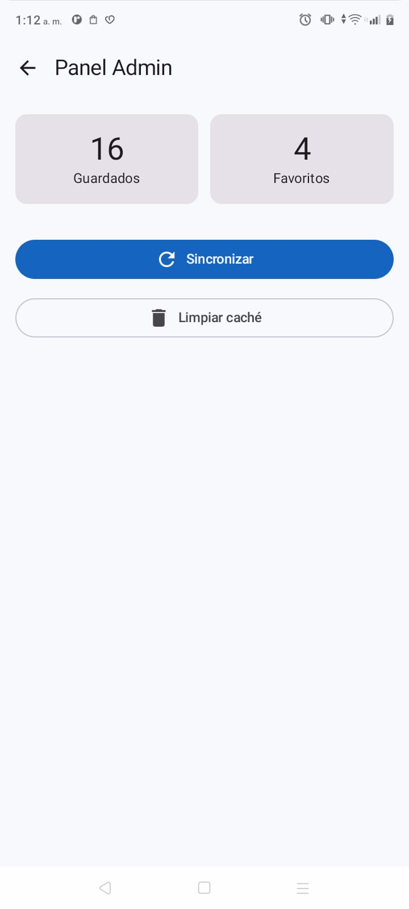
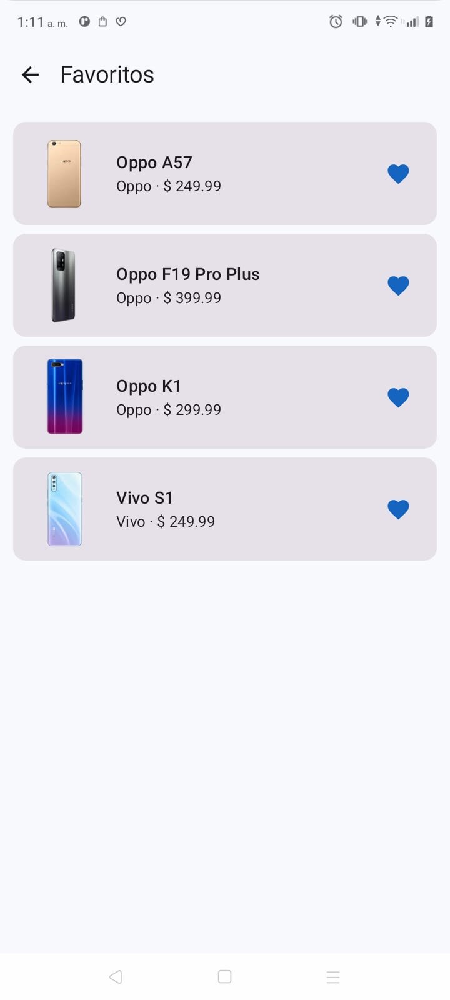
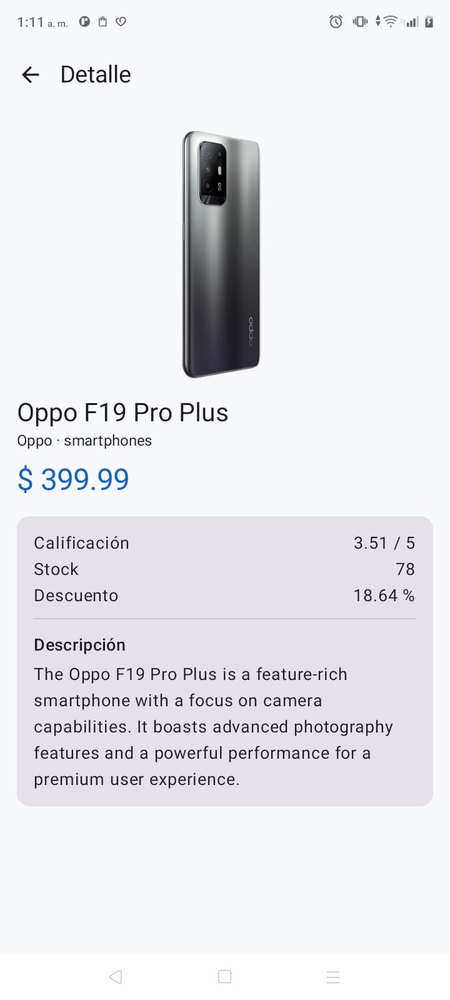
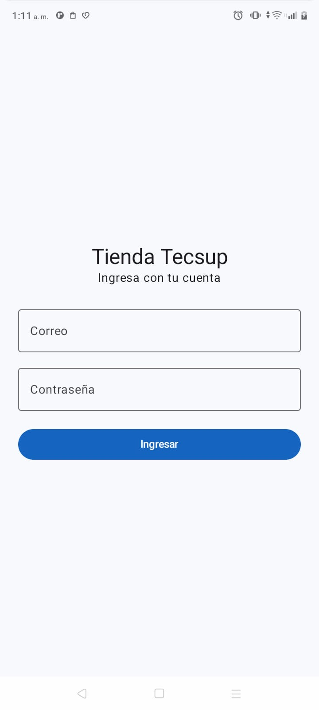
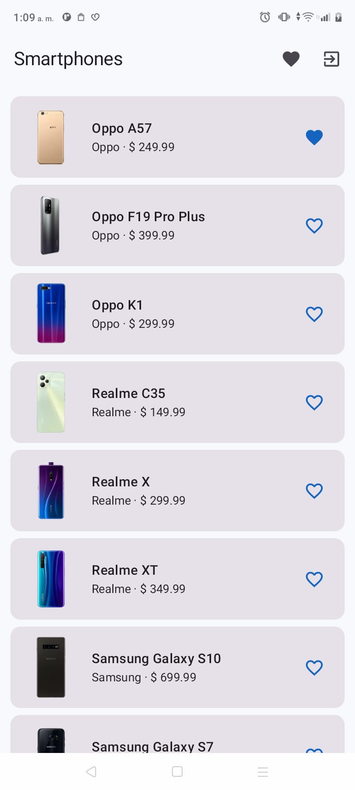
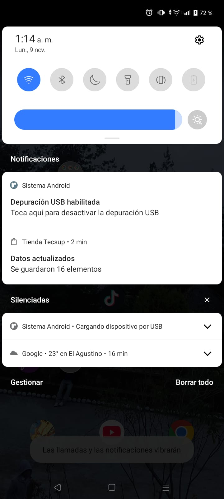

# Laboratorio 11-12 · Tienda Tecsup (Productos)

App Android en Kotlin + Jetpack Compose que aplica **MVVM** con **Retrofit**, **Room**,
**Firebase Authentication + Firestore** y **notificaciones locales**.

| Dato | Valor |
|---|---|
| Curso | Programación en Móviles · 4to ciclo |
| Grupo | G01 |
| Integrante | Luis Maldonado |
| Tema | **Productos** (dummyjson.com) |
| Variante | Categoría **smartphones** (`AppContainer.CATEGORIA`) |
| Paquete | `com.tecsup.productos` |

## Endpoints

| Uso | URL |
|---|---|
| Lista | `https://dummyjson.com/products/category/smartphones` → `{ "products": [...] }` |
| Detalle | `https://dummyjson.com/products/{id}` |

## Cómo compilar

1. Clonar el repositorio y abrirlo con Android Studio.
2. Crear el proyecto de Firebase y colocar `google-services.json` dentro de `app/`
   (instrucciones paso a paso en [`firebase/README.md`](firebase/README.md)).
   El archivo está en `.gitignore`: **no se sube al repositorio**.
3. *File → Sync Project with Gradle Files* y luego *Build → Rebuild Project*.
4. Ejecutar en un emulador **con Google Play** o un celular físico (API 33 o superior para probar el permiso de notificaciones).

## Usuarios de prueba

Se crean en la consola de Firebase (Authentication → Usuarios) y su rol se guarda en
Firestore en la colección `usuarios`, documento con **ID = UID** y campos `rol` y `nombre`.

| Correo | Contraseña | `rol` en Firestore | Ve |
|---|---|---|---|
| admin@tecsup.edu.pe | 123456 | `admin` | Catálogo + Favoritos + **Panel Admin** |
| usuario@tecsup.edu.pe | 123456 | `usuario` | Catálogo + Favoritos |

> El rol **no** está escrito en el código: `FirebaseAuthRepository.leerSesion()` lo lee de Firestore
> y `AppNav` solo muestra u oculta el acceso al panel según `Sesion.rol`.

## Arquitectura (MVVM)

```
ui/ (Compose)  --observa StateFlow<UiState>-->  ViewModel  --interface-->  Repository  -->  Room (verdad) <-- Retrofit
                                                                            AuthRepository -> Firebase
```

- **Tres modelos**: `ItemDto` (API) → `ItemEntity` (Room) → `Item` (UI). Los convierten los `Mappers`.
- **Room es la fuente única de verdad**: la lista sale de `ItemDao.todos()`; Retrofit solo la actualiza en `refrescar()`.
- **Favoritos sobreviven a la sincronización**: `refrescar()` lee `idsFavoritos()` antes del `@Upsert` y los reaplica.
- **El ViewModel no recibe Context**: la notificación se pide por la interface `Notificador`.
- **ViewModelFactory** recibe el `AppContainer` y entrega las interfaces a cada ViewModel.

Estructura de paquetes:

```
com.tecsup.productos
├── MainActivity.kt · ProductosApp.kt · AppContainer.kt
├── data/ remote (ApiService, RetrofitClient, dto) · local (Entity, Dao, Database)
│         auth (AuthRepository, FirebaseAuthRepository) · repository · mapper
├── domain/model (Item, Sesion + Rol)
├── notification (Notificador, NotificadorAndroid)
└── ui/ UiState · ViewModelFactory · navigation · login · lista · detalle · favoritos · admin · components · theme
```

## Capturas
| Login | Lista | Detalle |
|---|---|---|
|  |  |  |

| Favoritos | Panel Admin | Notificación |
|---|---|---|
|  |  |  |

## Pruebas de aceptación

Las 14 pruebas (PA-01 a PA-14) de la guía se ejecutaron en el dispositivo antes de entregar.
Para PA-08/PA-09 se usa el modo avión; para PA-14 se niega el permiso en el primer diálogo.

## Reparto de tareas

| Integrante | Hitos |
|---|---|
| Luis Maldonado | H1 a H16 (trabajo individual) |

## Fase 2 (rama `mejora-ia`)

Pruebas unitarias del `ListaViewModel` con repositorio falso, mejoras de interfaz y de manejo de errores.
Cada consulta a la IA está documentada en `PROMPTS.md`.
